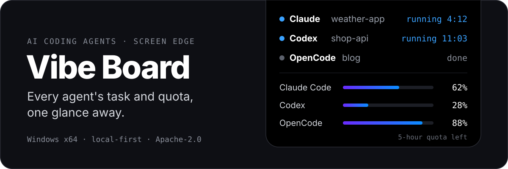
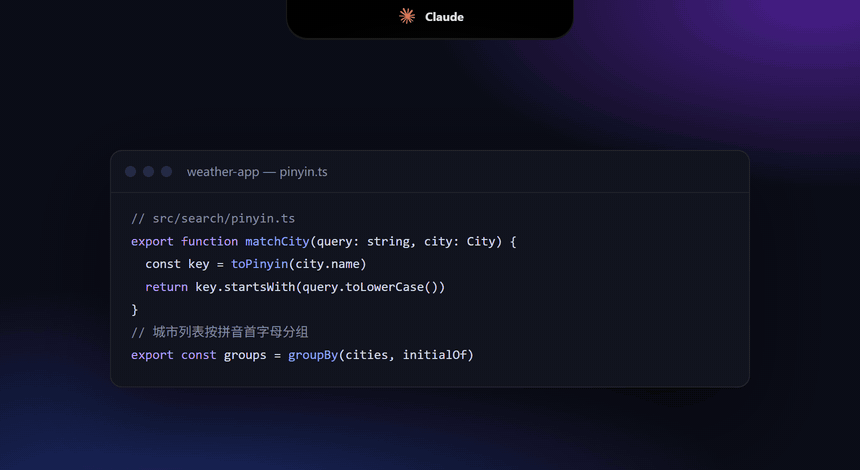
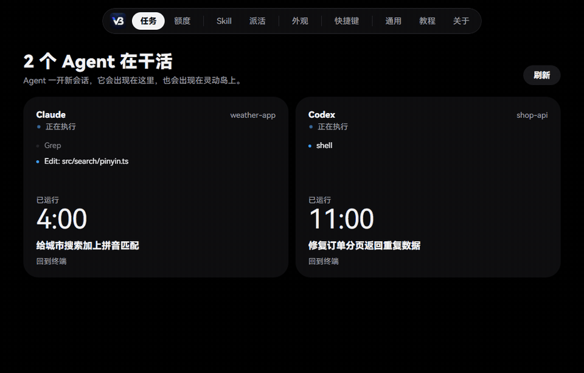
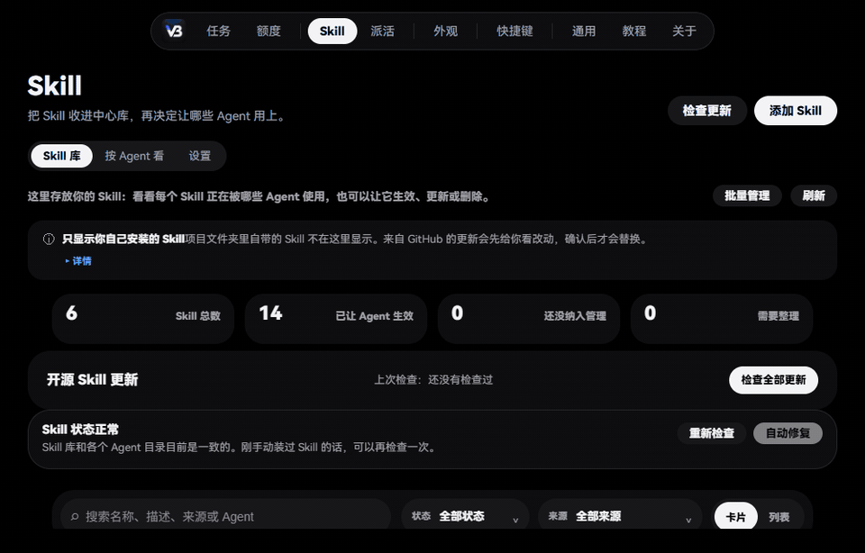

<div align="center">
  

  <p>
    <strong>A screen-edge task board for AI coding agents</strong><br />
    Vibe Board is a local-first Tauri desktop app that collects task status and usage from Claude Code, Codex, Gemini CLI, OpenCode, Antigravity, and other agents into one board docked to the screen edge.
  </p>

  <p>
    <a href="./README.md">中文</a> ·
    <a href="./ROADMAP.md">Roadmap</a> ·
    <a href="./RELEASING.md">Releases</a> ·
    <a href="./UPSTREAM.md">Upstream &amp; license</a> ·
    <a href="./docs/privacy-policy.md">Privacy</a>
  </p>

  <p>
    <a href="https://github.com/hyNous/vibe-board/releases/latest"></a>
    
    
    
  </p>
</div>

## See it in action

**Tasks on the island**: once an agent starts working, a small bar appears at the top of the screen. Hover over it to see what each task is doing, which agents are online, and how much quota is left. New tasks join the list on their own; finished ones are marked as completed.



**Tasks and quota**: in the settings window every running agent gets its own lane with the tool it is using and how long it has run. The quota page gathers each tool's 5-hour and weekly remaining quota and reset time, and online queries can be turned on one tool at a time.



**Skill management**: all skills live in one central library. You can see which agents use each skill, filter by agent, and decide where to distribute it.



<sub>The animations show Vibe Board's real interface (in Chinese; English is built in) filled with made-up demo tasks and quotas. They can be re-recorded with [scripts/readme-demo](./scripts/readme-demo/record.mjs) whenever the UI changes.</sub>

## What it is

Vibe Board lives at the top or side edge of the screen. Expanding it shows the current tasks, which agents are online, and their quota. It solves three everyday problems:

- With several agents running at once, you can see each task's conversation title and state without switching windows.
- Clicking a task jumps back to its terminal; desktop agents open and bring their app window to the front.
- You see quota running low before it runs out, without checking each tool; online queries are off by default and enabled per tool.

## Windows install (x64, unsigned)

1. Download the latest package from [GitHub Releases](https://github.com/hyNous/vibe-board/releases), or use the checked-in [Vibe Board-latest-setup.exe](./releases/Vibe%20Board-latest-setup.exe).
2. Install and launch Vibe Board. The first run opens the setup wizard: it scans the agents installed on the machine, then you pick the agents to connect and approve setup.
3. The wizard installs the selected hooks, saves startup options, and verifies the result; a failed check stays in the wizard with an error. Sessions of the connected agents then reach the board (starting the board on session start is off by default and enabled per agent).
4. To change the choice later, open **Settings → General → Connected Agents**.

The installer is an unsigned Windows x64 build, so SmartScreen may ask for confirmation. Automatic updates are disabled; releases are downloaded manually from GitHub. The full first-run, permission, and migration notes are in [Product setup](docs/product-setup.md).

## What it can do

| Capability | Details |
| --- | --- |
| Task board | Shows the current task, agent online state, and completion reminders. The task area scrolls and shows only the agent, conversation title, and execution state — never conversation bodies. |
| Quota | Each agent's 5-hour and weekly remaining quota and reset time, optionally shown on the island. Reading local logs needs no permission; online queries are off by default and are turned on one tool at a time on the Quota page, using the login that tool already stores on this machine. They can be turned off at any time. |
| Agent connection | The first-run wizard scans the agents installed on the machine and you pick which ones report task status to the board; change it later on the General page. Custom agents are supported. |
| Dispatch | Let one agent hand tasks to another, adding or removing workers per main agent. |
| Skill management | Imports from an agent, local folder, or GitHub; adopts into the center library; distributes by symlink or copy. |
| Look and docking | Solid black by default with an optional frosted-glass effect; docks to the top or either side edge, with three side sizes. |

## Sync boundary

Hooks and local app-server events are the real-time path. A fallback poll runs every three seconds by default (adjustable from 1 to 30 seconds), and Codex also falls back to local rollout logs.

Coding agents do not expose one stable, universal task-lifecycle interface, so synchronization is best-effort and cannot guarantee that every running task is captured. Process scanning only confirms that an agent is online and is not used to create tasks. Vibe Board does not put session content through a hosted relay and collects no usage statistics: conversation bodies, tool details, and raw hook input never reach the board.

## Build from source

Requirements: Node.js 20+, pnpm, Rust/Cargo, and the Tauri CLI. Windows also needs Microsoft C++ Build Tools and WebView2.

```bash
git clone https://github.com/hyNous/vibe-board.git
cd vibe-board
pnpm install
pnpm tauri:dev
```

For browser-only UI work: `pnpm dev` (http://localhost:1423). Run the repository checks before submitting:

```bash
pnpm lint
pnpm test:run
pnpm build
cargo check --manifest-path src-tauri/Cargo.toml
```

## License and provenance

Vibe Board code is released under the [Apache License 2.0](./LICENSE), while the upstream [NOTICE](./NOTICE) and branding boundary in [TRADEMARKS.md](./TRADEMARKS.md) remain in the repository.

This is an independent modification based on [AgentBro](https://github.com/shirenchuang/agentbro): the product name, icons, and release configuration have been replaced, and this repository is not an official upstream distribution. See [UPSTREAM.md](./UPSTREAM.md) for details. Versioning, releases, and the roadmap are decided in this repository and do not follow the upstream release line — see [RELEASING.md](./RELEASING.md) and [ROADMAP.md](./ROADMAP.md). Issues and pull requests are welcome; read [CONTRIBUTING.md](./CONTRIBUTING.md) first.
